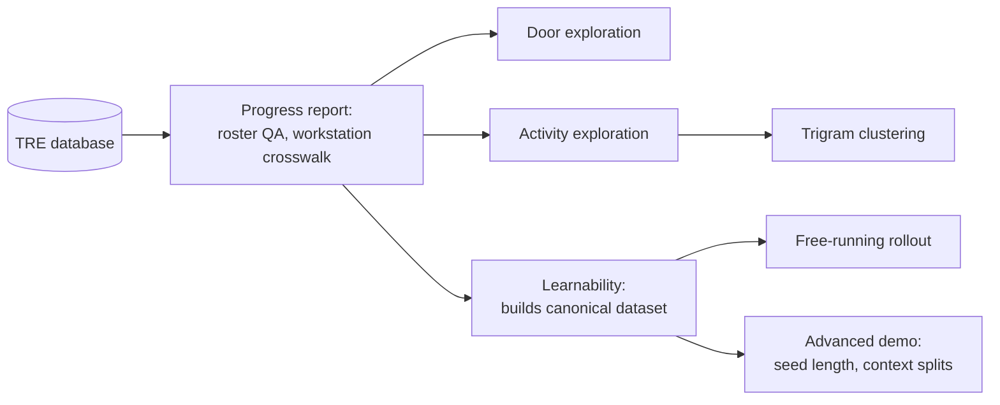

# AMR-HUB Analysis Handover

October 2026. Code: `github.com/UCL-ARC/amr-hub`, folder `learning-from-data/`.
All outputs are in the TRE; none are in the repository.

The aim was to check two things before fitting IRL or building a worker
simulator: whether the electronic records can be turned into staff
trajectories with a usable spatial frame, and whether those trajectories have
enough sequential structure to learn from.

The engine that runs RL algorithms in a simulation, or IRL can be described as:

[a](current agent state) --(b)---> [next agent state]

Main goal of these set of analyses were to:

(a) Understand the "informative" states that should be saved and passed as the (state,action) pair in any simulation. These variables either can go through an ABM based logic or an ML algorithm

(b) Decide what kind of algorithm is minimally sufficient to inform a policy/behaviour strategy that is

1. natural/similar to human movement
2. intelligent to learn and operate within new constraints ex infection spread

One main idea here was to explore the possibility of training an Inverse-Reinforcement Learning algorithm that could, given our discovery in (a) and that it has a spatial correspondence, could be implemented as a "policy" in the AMR simulation being built, with general variables of interest for what reward functions would likely include, that would rollout with the existing TRE data, to recover the best reward function that would explain this TRE data. More on the idea behind, and eventually we didn't implement IRL, is covered in another document (shared in PR #219).

## Glossary

| Term                                                         | Meaning                                                                                                                                                                                                               |
| ------------------------------------------------------------ | --------------------------------------------------------------------------------------------------------------------------------------------------------------------------------------------------------------------- |
| Shift                                                        | A roster interval for one staff member, from Roster Start to Roster End (paired by `LinkKey`).                                                                                                                        |
| Activity class                                               | Event type: Flowsheet (FS), Workstation (WS) or Door Message. Roster events are not activities.                                                                                                                       |
| Canonical dataset                                            | `canonical_events.parquet`: cleaned, ordered events per shift, with pseudonymous staff and shift IDs. Input to the later analyses.                                                                                    |
| Resolved location                                            | An event mapped to a room or door point. Unresolved events are kept but not given a location.                                                                                                                         |
| Door point                                                   | A door identified by its parsed code and key, e.g. `doorpoint:XX00A#DOORKEY:000`. Gives no direction.                                                                                                                 |
| Workstation crosswalk                                        | Table mapping workstations to rooms, inferred from the same staff member's nearby flowsheet rooms. **Support** is the number of nearby flowsheet observations; **share** is the fraction naming the most common room. |
| State                                                        | What the model conditions on, e.g. current and previous activity class or room.                                                                                                                                       |
| Context                                                      | Extra conditions: time bucket, role, roster unit.                                                                                                                                                                     |
| Time bucket                                                  | Six-hour band of the event time: `00–06`, `06–12`, `12–18`, `18–24`.                                                                                                                                                  |
| Majority baseline                                            | Always predicts the most common next value in training.                                                                                                                                                               |
| Markov (first-order) model                                   | Predicts the next value from the current one only.                                                                                                                                                                    |
| Count-based model                                            | For each exact state, predicts the most frequent next value seen in training.                                                                                                                                         |
| Pair                                                         | One training or test example: the state at an event and the value at the next event in the same shift.                                                                                                                |
| Task                                                         | What is predicted: `next_class` (next activity class), `next_room_observation` (next room-resolved event, repeats kept), `next_room_change` (next different room).                                                    |
| `majority`                                                   | Model label: majority baseline, no state.                                                                                                                                                                             |
| `markov_current_class` / `markov_current_room`               | Model label: first-order model on the current class or room.                                                                                                                                                          |
| `current_plus_previous_class` / `current_plus_previous_room` | Model label: current and previous class or room.                                                                                                                                                                      |
| `plus_time_role`, `plus_time`, `plus_role`                   | Model labels: the previous model with time bucket and/or role added (see Section 5).                                                                                                                                  |
| `full_context`                                               | Model label: all state and context variables for that task (see Section 5).                                                                                                                                           |
| Pooled / subgroup                                            | Pooled results use all shifts; subgroup results repeat the test within one role or roster unit.                                                                                                                       |
| Shift-held-out split                                         | Whole shifts go to train (80%) or test (20%). The same person can appear in both.                                                                                                                                     |
| Top-1 / top-3                                                | Correct if the true value is the first / among the first three predictions.                                                                                                                                           |
| Unseen-state fraction                                        | Share of test cases whose state never appeared in training (the model falls back to the overall ranking).                                                                                                             |
| Entropy / information gain                                   | Uncertainty of the next value, and how much a state reduces it. Descriptive, in-sample.                                                                                                                               |
| Trigram                                                      | Three consecutive activity classes, e.g. `WS → FS → WS`.                                                                                                                                                              |
| Calinski–Harabasz score                                      | Cluster-separation score used to compare numbers of clusters; higher is better.                                                                                                                                       |
| Transition concentration                                     | Share of transitions that go to the most common next class. In-sample.                                                                                                                                                |
| Free-running rollout                                         | Generating a shift's sequence by feeding predictions back in, after a few real seed events.                                                                                                                           |
| Correct prefix                                               | Number of generated events that are correct before the first error.                                                                                                                                                   |
| TV distance                                                  | Difference between generated and real activity-class proportions; 0 means identical.                                                                                                                                  |
| BC / IRL                                                     | Behaviour cloning (learn actions directly from data) / inverse reinforcement learning (infer the reward behind the behaviour). Not fitted here.                                                                       |

## Outline of the analysis

| Step                    | Question                                                  | Folder or file in `learning-from-data/`                             |
| ----------------------- | --------------------------------------------------------- | ------------------------------------------------------------------- |
| 1. Progress report      | Can shifts be rebuilt and events placed in rooms?         | `legacy/amr_hub_progress_report/`                                   |
| 2. Door exploration     | Are door messages a usable movement signal?               | `legacy/amr_hub_door_jupyter_existing/`                             |
| 3. Activity exploration | What do activity mix and transitions look like?           | `legacy/amr_hub_activity_exploration/`                              |
| 4. Trigram clustering   | Do shifts fall into distinct groups?                      | `legacy/amr_hub_cluster_meeting/` (trigram stage not in repo)       |
| 5. Learnability         | Can the next class or room be predicted on unseen shifts? | `legacy/amr_hub_learnability_bundle/`                               |
| 6. Free-running rollout | Do predictions hold up when fed back in?                  | `AMR_HUB_Free_Running_Rollout.ipynb`                                |
| 7. Advanced demo        | Does more seed history or a context-specific policy help? | `legacy/amr_hub_advanced_demo/`, `AMR_HUB_Advanced_RISE_Demo.ipynb` |

## Data preparation

- The extract covers staff in **two roster units**. Event and staff counts
  are produced by the progress report inside the TRE and are not reproduced
  here.
- Shifts: Roster Start and End paired by staff and `LinkKey`; valid if both
  exist and end is after start. Events inside a shift are assigned to it. If
  shifts overlap, the canonical dataset assigns the event to the one with the
  latest start. The progress report, activity and door exploration instead
  count it in each.
- Role comes from the staff reference table; missing role or unit is
  `unknown`.
- Raw staff IDs stay in DuckDB. The canonical dataset has no absolute
  timestamps unless `--include-timestamps` is set.

| Source       | Mapping                                                                                                        | Limitation                                      |
| ------------ | -------------------------------------------------------------------------------------------------------------- | ----------------------------------------------- |
| Flowsheet    | `SourceKey` → `Ref.Department.RoomName`, stored as `room:<NAME>`                                               | Only direct room mapping                        |
| Workstation  | Crosswalk: flowsheet rooms by the same person within ±10 min; support ≥ 20 in all data, share of a room ≥ 0.60 | Partial: 13 of 36 mapped in the exploratory run |
| Door Message | Code parsed from `DoorName`, stored as a door point                                                            | 12 of 13 doors had a code; no direction         |
| Other        | Kept as events with no location                                                                                | Excluded from spatial analyses                  |

## Analyses

### 1. Progress report

`legacy/amr_hub_progress_report/generate_progress_report.py`. Rebuilds shifts and
summarises staff, shifts, units, durations and date range; audits door and
workstation references; infers the workstation crosswalk (`--window-min`,
`--min-support`, `--min-share`); reports mapping coverage and one example
sequence. The same image runs JupyterLab with `AMR_HUB_BC_Triage.ipynb`, an
earlier behaviour-cloning prototype (doors as edges, seed `0`; not comparable
with step 5).

### 2. Door exploration

`legacy/amr_hub_door_jupyter_existing/`. Door messages per shift and per rostered
hour, door count vs shift length, minutes and non-door events between
consecutive doors, and a door-to-door transition matrix. Messages are not
deduplicated by default (`--door-dedupe-seconds 0`). The separate network
figure script is not in the repository.

### 3. Activity exploration

`legacy/amr_hub_activity_exploration/`. Events per hour, activity mix per shift,
distinct locations, location changes per hour, class transition probabilities
(pooled and per shift), and location transitions (repeats of the same location
ignored; heatmap of the top 20 locations).

### 4. Trigram clustering

The trigram stage (not in the repository) represented each shift by its
trigram proportions (shifts with at least 10 trigrams), ran K-means for
`k = 2–6` and compared Calinski–Harabasz scores. `legacy/amr_hub_cluster_meeting/`
reads those outputs and draws a 2-D embedding, transition matrices per cluster
and transition concentration.

### 5. Learnability

`legacy/amr_hub_learnability_bundle/`. Builds the canonical dataset, then tests
prediction on held-out shifts (80/20 by shift, seed `20260813`):

- Targets: next activity class; next room observation (repeats kept); next
  room change (repeats collapsed). Door points are not rooms here.
- Each model counts next values per exact state in the training pairs and
  predicts the most frequent (ties broken alphabetically); top-3 is the three
  most frequent. Test states never seen in training fall back to the overall
  top-3 from training.
- Subgroups: role and roster unit with at least 30 shifts and 100 test pairs,
  for both room tasks, using `majority`, `markov_current_room` and
  `full_context`.

Models (labels as in the output files):

| Model                                                        | `next_class` state                                         | Room tasks state                                                         |
| ------------------------------------------------------------ | ---------------------------------------------------------- | ------------------------------------------------------------------------ |
| `majority`                                                   | none                                                       | none                                                                     |
| `markov_current_class` / `markov_current_room`               | current class                                              | current room                                                             |
| `current_plus_previous_class` / `current_plus_previous_room` | current and previous class                                 | current and previous room                                                |
| `plus_time_role` (class) / `plus_time` (room)                | current and previous class, time bucket, role              | current and previous room, time bucket                                   |
| `plus_role` (room only)                                      | n/a                                                        | current and previous room, time bucket, role                             |
| `full_context`                                               | current and previous class, time bucket, role, roster unit | current and previous room, time bucket, role, current class, roster unit |

Output files and columns:

- `pooled_learnability.csv`: `task`, `population` (`pooled`), `model`,
  `train_pairs`, `test_pairs`, `train_shifts`, `test_shifts`, `top1`, `top3`,
  `unseen_state_fraction` (always 0 for `majority`).
- `subgroup_learnability.csv`: the same, plus `group_type` (`role` or
  `roster_unit`), `group_value` and `group_shifts_total`.
- `entropy_summary.csv`: per task, `conditioning_state` (current class or
  room), `H_action_bits`, `H_action_given_state_bits`,
  `information_gain_bits`. Calculated on all pairs, not held out.
- `quality_summary.csv`: counts of events, shifts, staff, resolved events,
  overlapping intervals and pairs per task.
- `LEARNABILITY_REPORT.md` and figures `01`–`05` summarise the above.

### 6. Free-running rollout

`AMR_HUB_Free_Running_Rollout.ipynb`. Same split and the five `next_class`
models from step 5. Each test shift is seeded with its first two real classes; the
rest is generated. Role and unit are given; the time bucket comes from the real
event times, so timing is not generated. Reports rollout accuracy, exact
match, correct prefix, unseen-state fraction and TV distance, and compares
them with one-step accuracy.

### 7. Advanced demo

`legacy/amr_hub_advanced_demo/`. Rollouts with **1, 2, 3, 5 and 10** seed events,
global policies for all five class models, and policies fitted separately by
time bucket, role or unit (only for segments with at least **1,000** training
pairs, otherwise global). Also Markov matrices by time, role and unit.
`AMR_HUB_Advanced_RISE_Demo.ipynb` shows the figures and IRL design notes.

## Main findings

- Shifts can be rebuilt from roster boundaries.
- Flowsheets are the only direct room mapping; workstation mapping is partial
  (13 of 36); door codes were found for 12 of 13 doors, but doors give no
  direction.
- Door messages are too sparse and uneven to be the main movement signal. Many
  shifts have very few. They are kept as context.
- Activity sequences have strong local persistence, especially `WS → WS` and
  `FS → FS`.
- Next activity class (top-1): about **76%** with the majority baseline,
  **88.6%** with current + previous class, **88.7%** with full context. Local
  history roughly halves the error rate; time, role and unit add about 0.1
  points. This says nothing yet about where staff go next.
- Clustering: `k = 3` scored best for `k = 2–6`, but clusters overlap and look
  like a continuum. Treat them as an exploratory grouping, not staff types.
- Spatial learnability and rollout results are in the TRE and are not
  reproduced here.

Not in the repository and would need recovering: the trigram clustering stage,
the door network figure script, the door → ABM export scripts
(`legacy/amr_hub_door_to_abm_timeseries.py`, `legacy/amr_hub_door_matching_only.py`; the
door crosswalk was never completed) and `AMR_HUB_RISE_Demo.ipynb`. The door
code parser also exists in the simulation package as
`legacy/amr_hub_abm.data_ingestion.door_mapping.read_door_mapping()`.

## Running the analyses

Build images outside the TRE, `docker save`, import through the airlock. Mount
the database folder read-only at `/data` and an output folder at `/outputs`.
Scripts use the only `.db`/`.duckdb` file in `/data`, or `--db FILE`.

| Script                                 | Input                 | Output under `/outputs/`                    | Run with                                                                  |
| -------------------------------------- | --------------------- | ------------------------------------------- | ------------------------------------------------------------------------- |
| `generate_progress_report.py`          | Database              | `progress_report/`, `ws_crosswalk.csv`      | Image `amr-bc-jupyter-report`, `--entrypoint /app/run_progress_report.sh` |
| `door_exploration_existing_jupyter.py` | Database              | `door_exploration/`                         | Copy into `/outputs`; run in JupyterLab                                   |
| `generate_activity_exploration.py`     | Database, crosswalk   | `activity_exploration/`                     | Image `amr-activity-exploration`                                          |
| `generate_learnability_analysis.py`    | Database, crosswalk   | `learnability_analysis/`                    | Image `amr-learnability`                                                  |
| `AMR_HUB_Free_Running_Rollout.ipynb`   | Canonical dataset     | `learnability_analysis/rollout_inspection/` | JupyterLab                                                                |
| `generate_advanced_demo_analysis.py`   | Canonical dataset     | `advanced_demo_analysis/`                   | Image `amr-advanced-demo`                                                 |
| `generate_cluster_meeting.py`          | Trigram-stage outputs | `cluster_meeting/`                          | Image `amr-cluster-meeting`                                               |

Order: progress report → activity exploration and learnability → rollout
notebook and advanced demo. Dockerfiles for activity exploration, cluster
summary and advanced demo were rebuilt from the TRE images' build history.

The original scripts above are in `learning-from-data/legacy/`. The top-level
folders `activity_exploration/`, `sequence_clustering/`, `learnability/`,
`rollout_analysis/` and `door_matching/` are short one-script-per-image
versions of these analyses, not exact reproductions. They expect `iclass` and `event_time` columns
(the canonical dataset has `interaction_class` and no timestamps by default),
use seed `42`, and leave out the trigram minimum, top-3, subgroups, the
1,000-pair minimum and door points.

## Checking outputs before export

- Keep in the TRE (event- or shift-level): `canonical_events.parquet`,
  `canonical_events_sample.csv`, `canonical_shift_summary.csv`,
  `shift_activity_features.csv`, per-shift transition files,
  `shift_door_activity.csv`, `door_episodes.csv`, rollout per-shift and
  example CSVs, the cluster embedding CSV, `example_sequence.csv`.
- Contain room names or door codes: `spatial_location_map_used.csv`, location
  transition files, `door_counts.csv`, `door_transition_matrix.csv`,
  `doors.csv`, `workstations.csv`.
- Subgroup thresholds count shifts or pairs, not people. Check that role and
  unit rows (in `subgroup_learnability.csv` and the segment Markov matrices)
  cover at least 10 staff, and that transition matrix cells are at least 10.
- `overall_summary.csv` has the first and last event timestamps.
