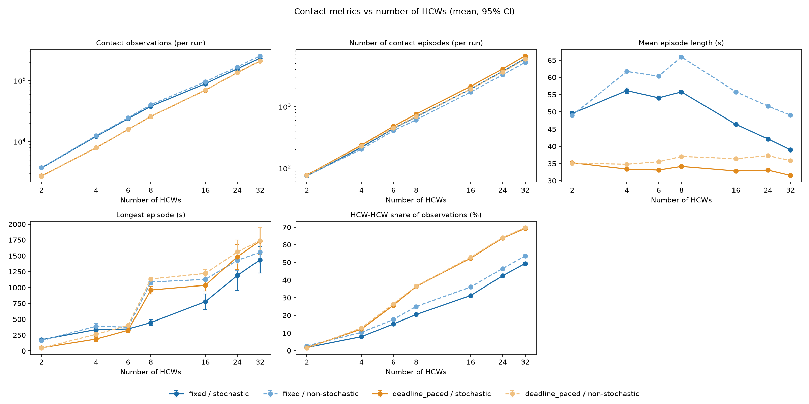
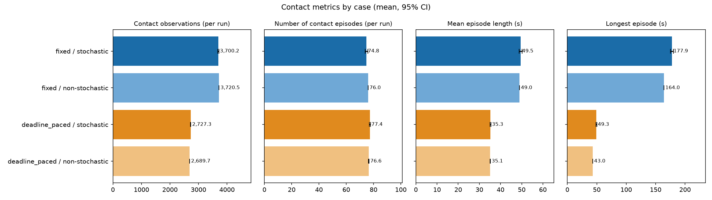
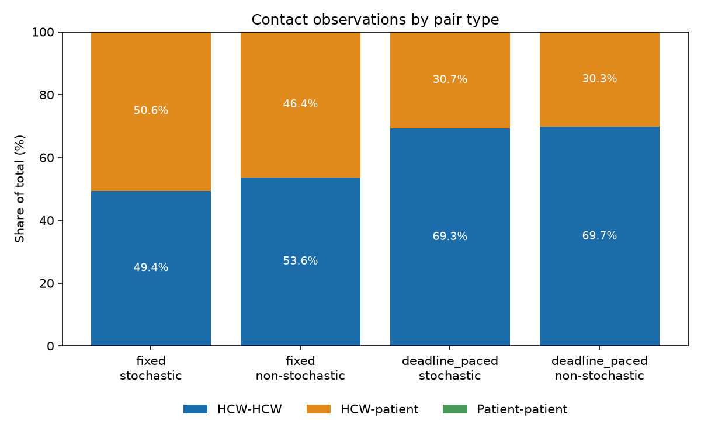

# Effect of Movement Strategy and Staffing Level on Simulated Contact Patterns

AMR-Hub agent-based model: contact analysis report

## Abstract

This report compares four agent movement configurations in the AMR-Hub
agent-based model and examines how simulated contact patterns scale with the
number of healthcare workers (HCWs). Thirty seeded replicates were run for
each combination of movement strategy (fixed speed, deadline-paced), movement
stochasticity (on, off) and HCW count (2, 4, 6, 8, 16, 24 and 32), giving 840
runs on a synthetic scenario. Contact volume grows far faster than staffing:
a 16-fold increase in HCWs (2 to 32) increased contact observations by about
63-79 times, driven by HCW-HCW pairs. Deadline-paced movement produced fewer
contact observations than fixed-speed movement at every HCW count, but the
relative reduction shrank from roughly 26-28% at 2 HCWs to about 10-17% at 32
HCWs, and it raised the HCW-HCW share of contacts. The results describe a small,
synthetic, over-subscribed layout and must not be generalised to real
hospitals.

## 1. Introduction

Contact between people is the pathway through which antimicrobial-resistant
organisms spread in the model, so the way agents move determines the contact
network on which transmission acts. Two questions motivate this analysis:

1. How does the choice of movement strategy change the amount and structure of
   contact?
2. How do contact metrics scale as the number of HCWs increases?

No transmission or infection dynamics are analysed here; the report concerns
contact only.

## 2. Methods

### 2.1 Simulation set-up

All runs use the synthetic scenario in `python-code/tests/inputs/`: a single
building layout, 4 patients and a simulation window of 06:55-19:05 with a
1-second timestep. One contact is recorded when a pair of agents is within
the contact-distance threshold (0.1 metres) at a recorded timestep; pairs located in
different known rooms are excluded. Episodes are maximal consecutive runs of
contact for a pair, and durations are converted to seconds using the timestep.

### 2.2 Movement strategies

| Strategy       | Description                                                                        |
| -------------- | ---------------------------------------------------------------------------------- |
| Fixed          | Agents move at the configured movement speed.                                      |
| Deadline-paced | Speed is the remaining distance divided by the time to the task's scheduled start. |

Each strategy was run with movement stochasticity (standard deviation of the variability of angular deviations) on (configured value 0.5) and
off (0), giving four cases.

### 2.3 Staffing levels

The 2-HCW condition is the original scenario. Larger conditions add synthetic
HCWs produced by `contact_analysis/generate_extra_hcws.py`; each performs
workstation work, patient rounds on the existing patients, and occasional WC
and restaurant visits. The same 4 patients are used in every condition. The
sweep was run with `contact_analysis/run_hcw_sweep.py`.

### 2.4 Replication and statistics

Each case and HCW count was replicated 30 times with fixed seeds. Reported
values are means across replicates with 95% Student-t confidence intervals.
Metrics are computed by `plot_contact_summary.py` and `plot_contact_types.py`
and aggregated by `plot_hcw_sweep.py`, which also writes
`python-code/contact_analysis/results/hcw_sweep_summary.csv`.

### 2.5 Metrics

- **Contact observations**: pair-timestep contacts per run. With a 1-second
  timestep this equals total pair-contact time in seconds.
- **Number of contact episodes** per run.
- **Mean and longest episode length** (seconds).
- **HCW-HCW share**: the percentage of contact observations that are between
  two HCWs (mean of per-run percentages).

## 3. Results

### 3.1 Scaling with number of HCWs



_Figure 1. Contact metrics against HCW count for each strategy and
stochasticity case._

Table 1 gives the mean contact observations and episodes per run at selected
HCW counts.

| HCWs | Fixed / on | Fixed / off | Deadline / on | Deadline / off |
| ---: | ---------: | ----------: | ------------: | -------------: |
|    2 |      3,700 |       3,721 |         2,727 |          2,690 |
|    4 |     12,155 |      12,483 |         7,892 |          7,930 |
|    8 |     37,825 |      40,141 |        25,729 |         25,649 |
|   16 |     89,039 |      95,927 |        69,804 |         70,035 |
|   32 |    233,534 |     255,268 |       209,797 |        211,303 |

_Table 1. Mean contact observations per run._

| HCWs | Fixed / on | Fixed / off | Deadline / on | Deadline / off |
| ---: | ---------: | ----------: | ------------: | -------------: |
|    2 |       74.8 |        76.0 |          77.4 |           76.6 |
|    4 |      216.6 |       202.3 |         236.3 |          227.7 |
|    8 |      678.2 |       608.9 |         752.7 |          691.6 |
|   16 |    1,920.6 |     1,718.6 |       2,124.0 |        1,922.5 |
|   32 |    5,990.8 |     5,202.6 |       6,644.9 |        5,882.7 |

_Table 2. Mean number of contact episodes per run._

Table 3 gives the HCW-HCW share of contact observations.

| HCWs | Fixed / on | Fixed / off | Deadline / on | Deadline / off |
| ---: | ---------: | ----------: | ------------: | -------------: |
|    2 |       1.8% |        2.7% |          1.7% |           1.4% |
|    6 |      15.1% |       17.7% |         25.7% |          26.5% |
|    8 |      20.5% |       25.0% |         36.4% |          36.5% |
|   16 |      31.3% |       36.1% |         52.4% |          52.9% |
|   24 |      42.4% |       46.5% |         63.7% |          64.1% |
|   32 |      49.4% |       53.6% |         69.3% |          69.7% |

_Table 3. HCW-HCW share of contact observations._

Key observations:

- **Superlinear growth.** For fixed speed with stochasticity on, contact
  observations rose from about 3.7 thousand (2 HCWs) to 234 thousand (32 HCWs),
  a factor of about 63 for a 16-fold increase in staff. This is consistent with
  the number of HCW pairs growing roughly quadratically, together with more
  HCW-patient overlap.
- **Episodes grow more slowly than contact time.** Episodes increased by about
  80-fold (74.8 to 5,991) for fixed/on while contact observations increased by about
  63-fold, but mean episode length fell at high HCW counts (fixed/on: 56 s at 4
  HCWs to 39 s at 32 HCWs), so contact is increasingly fragmented into more,
  shorter episodes.
- **Longest episodes lengthen.** Longest episodes exceed 1,000 s in every case
  at 16 or more HCWs (for example fixed/on rises from 447 s at 8 HCWs to 1,190 s
  at 24 HCWs), consistent with sustained co-location in shared rooms.

### 3.2 Comparison of movement strategies

- **Contact volume.** Deadline-paced movement produced fewer contact
  observations than fixed speed at every HCW count. The reduction was about 26-28%
  at 2 HCWs, about 32-37% at 4-8 HCWs, and about 10% (stochastic on)
  to 17% (off) at 32 HCWs, so the strategy effect shrinks as the layout becomes
  crowded.
- **Episode count and length.** Deadline-paced movement gave more but shorter
  episodes (mean about 32-37 s at every HCW count) than fixed speed (about
  39-66 s).
- **Pair-type composition.** The strategies differ in who contacts whom. At 32
  HCWs, deadline-paced movement gave about 64 thousand HCW-patient observations
  against about 118 thousand for fixed speed (about 46% lower), but about 145-147
  thousand HCW-HCW observations against 115-137 thousand. The HCW-HCW share is
  therefore consistently higher under deadline-paced movement (Table 3).
- **Stochasticity.** Switching stochasticity on or off changed results much
  less than changing the strategy. Non-stochastic fixed runs gave somewhat more
  contact and longer episodes; with deadline-paced movement the on/off
  difference in contact observations was small at 4 or more HCWs (about 1%).

### 3.3 Detailed small-population results

For the original scenario (2 HCWs, 4 patients) contact was almost entirely
HCW-patient (97.3-98.6%); patient-patient contact did not occur (See Table 3). With 6 HCWs the
HCW-HCW share rose to 15-27%. Figures broken down by pair type are in
`contact-counts-by-type.png`, `contact-duration-by-type.png`,
`contact-episodes-by-type.png` and `contact-summary.png` (2 HCWs), with the
corresponding sets in `six-hcw/` and `thirty-two-hcw/`; see
`contact-movement-strategy-report.md` for the full per-case tables.



_Figure 2. Contact metrics by case with 95% confidence intervals, 2 HCWs._



_Figure 3. Share of contact observations by pair type, 32 HCWs._

### 3.4 Task completion

In the original 2-HCW runs every case completed all scheduled WC and
restaurant occupancy tasks (8 WC and 8 restaurant visits per run, 100% of 16
tasks). Completion was not re-checked at higher HCW counts.

## 4. Discussion

Staffing level is the dominant driver of contact in this model: moving from 2
to 32 HCWs changes contact by almost two orders of magnitude, far more than the
choice of movement strategy. Movement strategy nonetheless matters, mainly
through composition rather than volume. Deadline-paced agents spend less time
close to patients but more time close to colleagues, which would change which
transmission routes (staff-to-staff versus staff-to-patient) dominate if
infection dynamics were added.

The following explanations are hypotheses and have not been tested: the
lengthening of the longest episodes and the shrinking strategy effect at high
HCW counts probably reflect crowding in the small Staff Room and the shared WC
and Restaurant, since with 32 HCWs there are only 3 workstations, one toilet
and 6 chairs. Deadline-paced agents arrive just in time and so may cluster at
shared resources, while fixed-speed agents arrive early and wait elsewhere.

## 5. Limitations

- The scenario is synthetic, with a single layout and only 4 patients; results
  should not be generalised to real hospital populations or workflows.
- Extra HCWs follow a generated schedule built for the scenario layout, and
  large counts over-subscribe shared resources (extra HCWs fall back to random
  points in the Staff Room when workstations are exhausted). High-HCW results
  show crowding effects rather than realistic staffing.
- Only contact is measured; no infection or transmission is modelled in these
  analyses.
- Confidence intervals reflect seed-to-seed variation only, not uncertainty in
  parameters such as the contact-distance threshold or movement stochasticity.
- Intermediate HCW counts (4, 8, 16, 24) are shown in Figure 1 and the tables
  above but do not have the per-pair-type figures of the 2, 6 and 32 HCW runs.

## 6. Reproducibility

Run from `python-code/` (see `contact_analysis/README.md`):

```bash
uv run python contact_analysis/run_hcw_sweep.py --hcw-counts 2 4 6 8 16 24 32 --replicates 30
uv run python contact_analysis/plot_hcw_sweep.py
```

Raw per-run metrics are in `python-code/contact_analysis/results/contact_pair_types_<N>hcw.csv`
and the aggregated summary is in `hcw_sweep_summary.csv`. All inputs are
synthetic.

## 7. Conclusions

1. Contact grows superlinearly with the number of HCWs, driven by HCW-HCW pairs.
2. Deadline-paced movement reduces total contact relative to fixed speed, but
   by a diminishing margin as staffing increases.
3. Deadline-paced movement shifts contact from HCW-patient to HCW-HCW pairs.
4. Movement stochasticity has a smaller effect than strategy or staffing.
5. Conclusions hold for the synthetic, over-subscribed scenario only.
