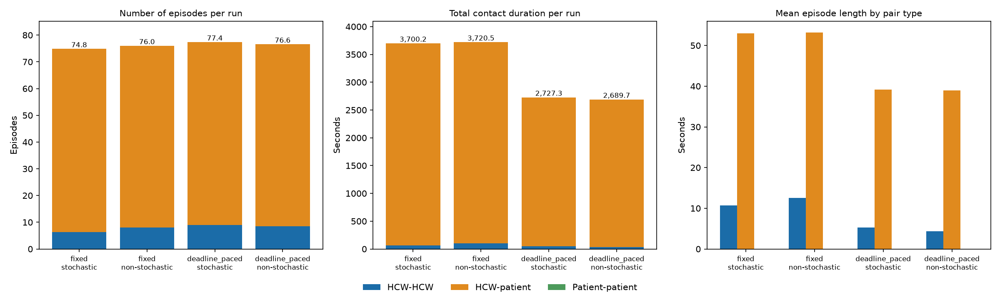
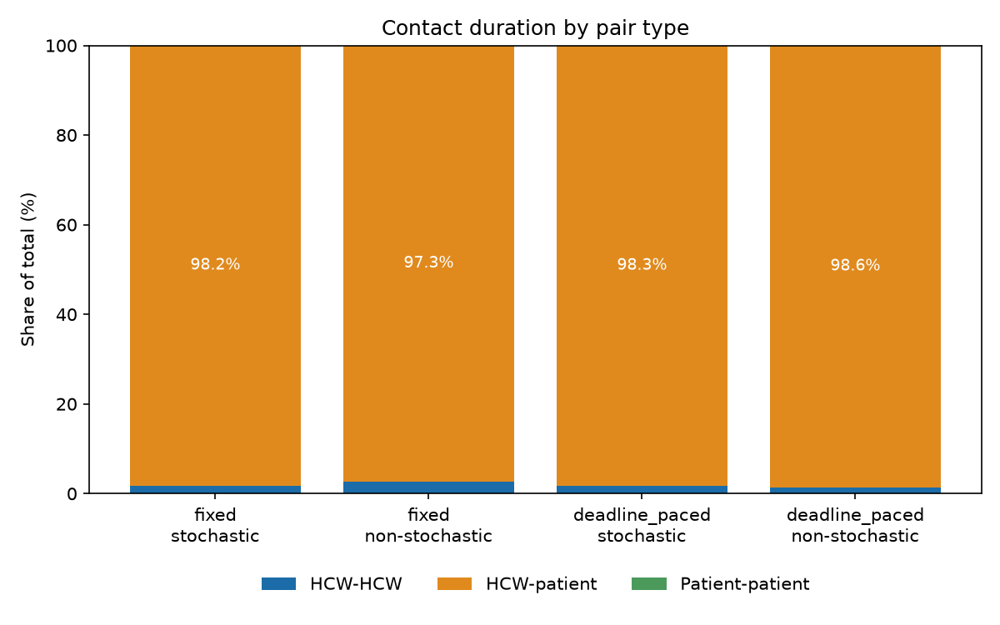

# Contact outcomes by movement strategy

## Study setup

We ran 30 seeded simulations for each combination of movement strategy and
stochasticity (120 runs total). All cases used the same synthetic input fixture,
simulation window (06:55-19:05), 1-second timestep, and contact-distance
threshold (0.1). The timestep matches the checked-in
`tests/inputs/simulation_config.yml`. Fixed speed used the configured movement
speed; deadline-paced speed used remaining distance divided by time to the task's
scheduled start. Stochastic runs used the configured movement stochasticity
(0.5); non-stochastic runs set it to zero.

Intervals below are 95% Student-t confidence intervals for the mean across
replicates. Contact observations count agent pairs within the distance threshold
at each recorded timestep, excluding pairs located in different known rooms.
Episode durations are converted to seconds using the 1-second timestep.

## Contact observations

The table gives overall contact statistics. The figure above shows contact
observations, number of episodes, mean episode length and longest episode per
case (mean with 95% CI).

The figures below split contacts by pair type (HCW-HCW, HCW-patient,
patient-patient) as the mean of per-run percentages.

| Case                            | HCW-HCW | HCW-patient | Patient-patient |
| ------------------------------- | ------: | ----------: | --------------: |
| Fixed / stochastic              |    1.8% |       98.2% |            0.0% |
| Fixed / non-stochastic          |    2.7% |       97.3% |            0.0% |
| Deadline-paced / stochastic     |    1.7% |       98.3% |            0.0% |
| Deadline-paced / non-stochastic |    1.4% |       98.6% |            0.0% |

The count and duration shares are identical here because with a 1-second
timestep each contact observation lasts one second, so total pair-contact time
equals the observation count. They differ at coarser timesteps. Patient-patient
contacts do not occur in this fixture. The figures are reproducible with the
scripts in `python-code/contact_analysis/` (see its README).

| Strategy       | Stochasticity |          Contact observations |             Episodes |      Unique pairs |         Total pair-contact time |           Mean episode |           Longest episode |
| -------------- | ------------- | ----------------------------: | -------------------: | ----------------: | ------------------------------: | ---------------------: | ------------------------: |
| Fixed          | On            | 3,700.20 [3,680.76, 3,719.64] | 74.83 [73.81, 75.85] | 5.00 [5.00, 5.00] | 3,700.20 s [3,680.76, 3,719.64] | 49.50 s [48.86, 50.14] | 177.90 s [175.46, 180.34] |
| Fixed          | Off           | 3,720.50 [3,719.93, 3,721.07] | 76.00 [76.00, 76.00] | 5.00 [5.00, 5.00] | 3,720.50 s [3,719.93, 3,721.07] | 48.95 s [48.95, 48.96] | 164.00 s [164.00, 164.00] |
| Deadline-paced | On            | 2,727.30 [2,720.55, 2,734.05] | 77.37 [76.93, 77.80] | 5.00 [5.00, 5.00] | 2,727.30 s [2,720.55, 2,734.05] | 35.26 s [35.08, 35.43] |    49.33 s [48.55, 50.11] |
| Deadline-paced | Off           | 2,689.67 [2,687.78, 2,691.55] | 76.57 [76.38, 76.75] | 5.00 [5.00, 5.00] | 2,689.67 s [2,687.78, 2,691.55] | 35.13 s [35.07, 35.19] |    43.00 s [43.00, 43.00] |

## Visit completion

Every run completed all fixture-scheduled WC and restaurant occupancy tasks:
8 WC visits and 8 restaurant visits per run (100% of the 16 scheduled visit
tasks). Since these counts were constant across replicates, their confidence
intervals collapse to the observed values.

## Interpretation and limitations

Under this fixture, fixed-speed movement produced more contact observations and
pair-contact time than deadline-paced movement. All four cases completed the
scheduled WC and restaurant visits. The non-stochastic outcomes varied slightly
across runs, so their confidence intervals are not all degenerate. This is a
small synthetic fixture with only a few agents; results describe this
configuration and should not be generalized to real hospital populations or
workflows.
