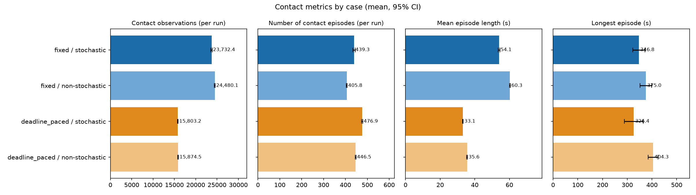
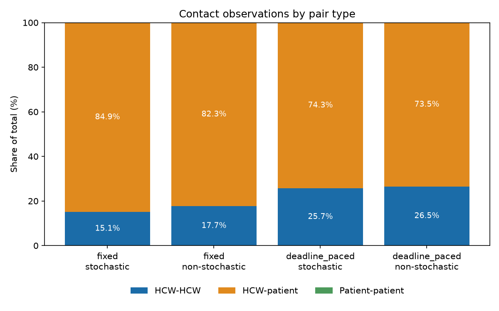
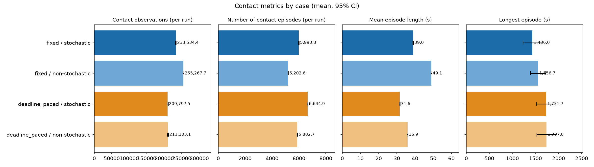

# Contact outcomes by movement strategy

## Study setup

We ran 30 seeded simulations for each combination of movement strategy and
stochasticity (120 runs total). All cases used the same synthetic input fixture,
simulation window (06:55-19:05), 1-second timestep, and contact-distance
threshold (0.1). The timestep matches the checked-in
`tests/inputs/simulation_config.yml`. Fixed speed used the configured movement
speed; deadline-paced speed used remaining distance divided by time to the task's
scheduled start. Stochastic runs used the configured movement stochasticity
(0.5); non-stochastic runs set it to zero.

Intervals below are 95% Student-t confidence intervals for the mean across
replicates. Contact observations count agent pairs within the distance threshold
at each recorded timestep, excluding pairs located in different known rooms.
Episode durations are converted to seconds using the 1-second timestep.

## Contact observations

The table gives overall contact statistics. The figure above shows contact
observations, number of episodes, mean episode length and longest episode per
case (mean with 95% CI).

The figures below split contacts by pair type (HCW-HCW, HCW-patient,
patient-patient) as the mean of per-run percentages.

| Case                            | HCW-HCW | HCW-patient | Patient-patient |
| ------------------------------- | ------: | ----------: | --------------: |
| Fixed / stochastic              |    1.8% |       98.2% |            0.0% |
| Fixed / non-stochastic          |    2.7% |       97.3% |            0.0% |
| Deadline-paced / stochastic     |    1.7% |       98.3% |            0.0% |
| Deadline-paced / non-stochastic |    1.4% |       98.6% |            0.0% |

The count and duration shares are identical here because with a 1-second
timestep each contact observation lasts one second, so total pair-contact time
equals the observation count. They differ at coarser timesteps. Patient-patient
contacts do not occur in this fixture. The figures are reproducible with the
scripts in `python-code/contact_analysis/` (see its README).

| Strategy       | Stochasticity |          Contact observations |             Episodes |      Unique pairs |         Total pair-contact time |           Mean episode |           Longest episode |
| -------------- | ------------- | ----------------------------: | -------------------: | ----------------: | ------------------------------: | ---------------------: | ------------------------: |
| Fixed          | On            | 3,700.20 [3,680.76, 3,719.64] | 74.83 [73.81, 75.85] | 5.00 [5.00, 5.00] | 3,700.20 s [3,680.76, 3,719.64] | 49.50 s [48.86, 50.14] | 177.90 s [175.46, 180.34] |
| Fixed          | Off           | 3,720.50 [3,719.93, 3,721.07] | 76.00 [76.00, 76.00] | 5.00 [5.00, 5.00] | 3,720.50 s [3,719.93, 3,721.07] | 48.95 s [48.95, 48.96] | 164.00 s [164.00, 164.00] |
| Deadline-paced | On            | 2,727.30 [2,720.55, 2,734.05] | 77.37 [76.93, 77.80] | 5.00 [5.00, 5.00] | 2,727.30 s [2,720.55, 2,734.05] | 35.26 s [35.08, 35.43] |    49.33 s [48.55, 50.11] |
| Deadline-paced | Off           | 2,689.67 [2,687.78, 2,691.55] | 76.57 [76.38, 76.75] | 5.00 [5.00, 5.00] | 2,689.67 s [2,687.78, 2,691.55] | 35.13 s [35.07, 35.19] |    43.00 s [43.00, 43.00] |

## Visit completion

Every run completed all fixture-scheduled WC and restaurant occupancy tasks:
8 WC visits and 8 restaurant visits per run (100% of the 16 scheduled visit
tasks). Since these counts were constant across replicates, their confidence
intervals collapse to the observed values.

## Six-HCW comparison

We repeated the experiment with 6 HCWs (the 2 original plus 4 generated by
`contact_analysis/generate_extra_hcws.py`, `tests/inputs/location_timeseries_extra.duckdb`),
with the same 4 patients, 1-second timestep, and 30 seeded runs per case. Values
are mean [95% CI] per run; the 2-HCW rows repeat the results above.

| HCWs | Strategy / stochasticity |    Contact observations |             Episodes |  Mean episode (s) |  Longest episode (s) | HCW-HCW share |
| ---- | ------------------------ | ----------------------: | -------------------: | ----------------: | -------------------: | ------------: |
| 2    | Fixed / on               |    3,700 [3,681, 3,720] |    74.8 [73.8, 75.9] | 49.5 [48.9, 50.1] | 177.9 [175.5, 180.3] |          1.8% |
| 2    | Fixed / off              |    3,721 [3,720, 3,721] |    76.0 [76.0, 76.0] | 49.0 [48.9, 49.0] | 164.0 [164.0, 164.0] |          2.7% |
| 2    | Deadline-paced / on      |    2,727 [2,721, 2,734] |    77.4 [76.9, 77.8] | 35.3 [35.1, 35.4] |    49.3 [48.6, 50.1] |          1.7% |
| 2    | Deadline-paced / off     |    2,690 [2,688, 2,692] |    76.6 [76.4, 76.8] | 35.1 [35.1, 35.2] |    43.0 [43.0, 43.0] |          1.4% |
| 6    | Fixed / on               | 23,732 [23,561, 23,904] | 439.3 [434.3, 444.3] | 54.1 [53.5, 54.6] | 346.8 [322.0, 371.6] |         15.1% |
| 6    | Fixed / off              | 24,480 [24,362, 24,598] | 405.8 [403.9, 407.8] | 60.3 [60.0, 60.6] | 375.0 [351.7, 398.3] |         17.7% |
| 6    | Deadline-paced / on      | 15,803 [15,708, 15,898] | 476.9 [474.1, 479.7] | 33.1 [32.9, 33.4] | 326.4 [288.0, 364.7] |         25.7% |
| 6    | Deadline-paced / off     | 15,875 [15,780, 15,970] | 446.5 [444.6, 448.5] | 35.6 [35.4, 35.7] | 404.3 [384.4, 424.3] |         26.5% |

Figures for the 6-HCW runs are in `six-hcw/` (`contact-summary.png`,
`contact-episodes-by-type.png`, `contact-counts-by-type.png`,
`contact-duration-by-type.png`).

Compared with 2 HCWs:

- Total contacts rise about 6.4x for fixed speed and 5.8x for deadline-paced
  movement, much more than the 3x increase in HCWs, as expected from the
  roughly quadratic growth in HCW pairs plus more HCW-patient overlap.
- Deadline-paced movement still produces about a third fewer contact
  observations than fixed speed (15.8k vs 23.7k), so the strategy effect
  persists, though the number of episodes is higher (about 477 vs 439).
- HCW-HCW contacts become a substantial share (15-27%) instead of 1-3%, and
  the share is higher under deadline-paced movement.
- The longest-episode advantage seen with 2 HCWs disappears: with 6 HCWs the
  longest deadline-paced episodes (326-404 s) are comparable to fixed ones
  (347-375 s), likely from HCWs queuing at shared workstations or amenities.
- Non-stochastic runs vary more with 6 HCWs than with 2, because shared
  resource conflicts amplify small timing differences.

The 6-HCW figures and table are reproducible with
`contact_analysis/run_experiments.py --location-path ... --output ...` and
`contact_analysis/compare_runs.py`. WC and restaurant visit completion was not
re-checked for the 6-HCW runs, and the explanations above are hypotheses, not
tested.

## 32-HCW comparison

A third set used 32 HCWs (the 2 original plus 30 generated with
`generate_extra_hcws.py --n-extra-hcws 30`,
`tests/inputs/location_timeseries_extra32.duckdb`), the same 4 patients, 1-second
timestep, and 30 seeded runs per case. Values are mean [95% CI] per run.

| HCWs | Strategy / stochasticity |       Contact observations |             Episodes |  Mean episode (s) |  Longest episode (s) | HCW-HCW share |
| ---- | ------------------------ | -------------------------: | -------------------: | ----------------: | -------------------: | ------------: |
| 32   | Fixed / on               | 233,534 [232,406, 234,663] | 5,991 [5,964, 6,018] | 39.0 [38.8, 39.2] | 1,436 [1,228, 1,644] |         49.4% |
| 32   | Fixed / off              | 255,268 [254,167, 256,368] | 5,203 [5,189, 5,217] | 49.1 [48.8, 49.3] | 1,557 [1,390, 1,723] |         53.6% |
| 32   | Deadline-paced / on      | 209,798 [208,047, 211,548] | 6,645 [6,621, 6,669] | 31.6 [31.3, 31.8] | 1,732 [1,521, 1,943] |         69.3% |
| 32   | Deadline-paced / off     | 211,303 [209,844, 212,763] | 5,883 [5,865, 5,901] | 35.9 [35.7, 36.2] | 1,738 [1,531, 1,944] |         69.7% |

Mean observations by pair type (per run):

| Case                 | HCW-HCW | HCW-patient |
| -------------------- | ------: | ----------: |
| Fixed / on           | 115,392 |     118,143 |
| Fixed / off          | 136,950 |     118,318 |
| Deadline-paced / on  | 145,365 |      64,432 |
| Deadline-paced / off | 147,291 |      64,012 |

Figures are in `thirty-two-hcw/`.

Compared with 2 and 6 HCWs:

- Contact volume keeps growing superlinearly (about 3.7k, 24k, 234k for
  fixed/stochastic at 2, 6 and 32 HCWs), dominated by HCW-HCW pairs.
- The strategy effect on total contact shrinks: deadline-paced gives about 10-17%
  fewer observations than fixed at 32 HCWs, against about a third fewer at 2 and
  6 HCWs.
- The two strategies now differ by pair type. HCW-patient contact is about 46%
  lower under deadline-paced movement (about 64k vs 118k), but HCW-HCW contact is
  higher (about 145k vs 115-137k), so HCW-HCW grows to 49-70% of contacts.
- Episodes are more numerous and shorter than with 6 HCWs for fixed speed (mean
  39-49 s vs 54-60 s), and the longest episode exceeds 1,400 s in every case.
- These long HCW-HCW episodes likely reflect crowding in the small Staff Room and
  shared WC and Restaurant (hypothesis, not tested). With 32 HCWs and only 3
  workstations, one toilet and 6 chairs, the layout is far over-subscribed, so the
  results mainly show the effect of crowding rather than realistic hospital
  staffing. WC and restaurant visit completion was not re-checked.

`run_experiments.py` and `compare_runs.py` reproduce these tables.

## Interpretation and limitations

Under this fixture, fixed-speed movement produced more contact observations and
pair-contact time than deadline-paced movement. All four cases completed the
scheduled WC and restaurant visits. The non-stochastic outcomes varied slightly
across runs, so their confidence intervals are not all degenerate. This is a
small synthetic fixture with only a few agents; results describe this
configuration and should not be generalized to real hospital populations or
workflows.
