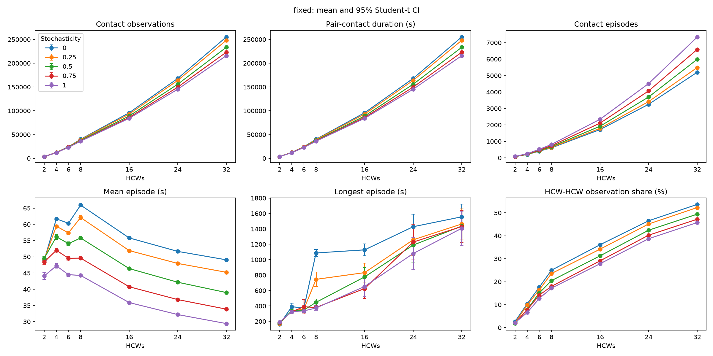
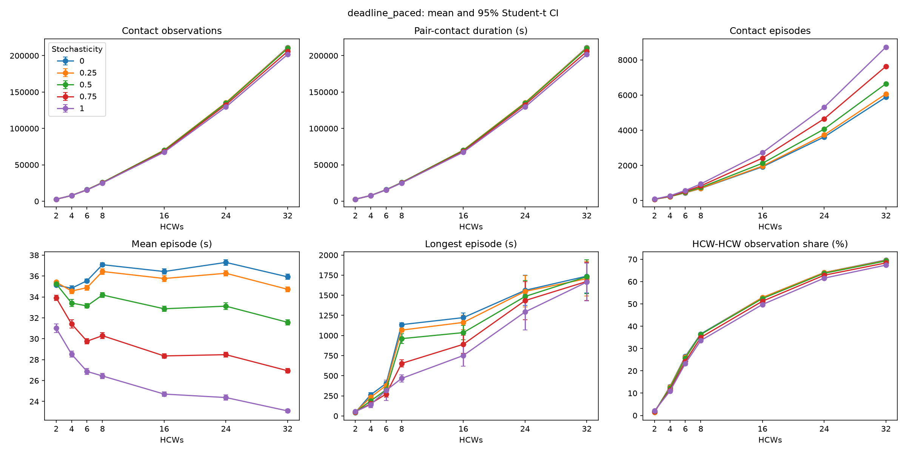

# Effect of Movement Stochasticity and Staffing Level on Simulated Contact Patterns

AMR-Hub agent-based model: stochasticity contact analysis report

## Abstract

This report compares five movement stochasticity levels (0, 0.25, 0.5, 0.75 and 1) across two movement strategies and seven healthcare-worker (HCW) counts. Thirty seeded replicates per combination gave 2,100 simulations using a synthetic layout with four patients. Contact increased strongly with staffing. Deadline-paced movement produced fewer contact observations and shorter mean episodes than fixed-speed movement in every matched condition. Increasing stochasticity from 0 to 1 generally divided contact into more, shorter episodes; at 32 HCWs, total contact fell by 15.4% for fixed speed and 4.6% for deadline pacing. The response was not uniformly monotonic, and the two-HCW scenario showed a small increase in total contact. These results describe the synthetic model, not clinical transmission risk.

## 1. Introduction

The way agents move determines how often and for how long they come into close proximity. This analysis extends the earlier on/off stochasticity comparison to five numeric levels. It asks how movement variability changes contact volume, episode length and the balance between staff–staff and staff–patient contact as staffing increases. No infection or transmission outcomes are analysed.

## 2. Methods

### 2.1 Simulation set-up

All runs use the same synthetic building layout, four patients and a 06:55–19:05 simulation window with one-second timesteps. HCW counts are 2, 4, 6, 8, 16, 24 and 32. Additional HCWs follow generated schedules involving workstations, patient rounds and shared facilities; the layout and patient population remain fixed.

A contact observation is recorded when two agents are within 0.1 metres at a sampled timestep; pairs in different known rooms are excluded. An episode is a consecutive sequence of observations for a pair. With one-second sampling, observation counts equal total pair-contact seconds. Simultaneous contacts between different pairs contribute separately.

### 2.2 Movement strategies and stochasticity

| Strategy       | Description                                                                     |
| -------------- | ------------------------------------------------------------------------------- |
| Fixed          | Uses the configured speed of 0.01 coordinate units per timestep.                |
| Deadline-paced | Adjusts speed using remaining distance and time until the scheduled task start. |

Both strategies were tested at stochasticity 0, 0.25, 0.5, 0.75 and 1. The parameter controls both heading noise (in degrees) and independent random multipliers on x/y displacement. It therefore changes step length and direction, and can reverse displacement components. This is not solely an angular-noise experiment. Other random processes remain active when stochasticity is zero.

### 2.3 Replication and metrics

Each of the 70 combinations has 30 seeded replicates, giving 2,100 successful CPU runs. Tables show means; figures show means and 95% Student-t confidence intervals across replicates. Metrics are contact observations, episode count, mean and longest episode length, and the HCW–HCW share of observations. Episode lengths and shares are calculated within each run before averaging. Intervals describe seed variability, not uncertainty about real hospital behaviour.

## 3. Results

### 3.1 Scaling with staffing

Contact observations increased with HCW count at every stochasticity level for both strategies. Table 1 shows the endpoint levels; Figures 1 and 2 include all five levels.

| HCWs | Fixed / 0 | Fixed / 1 | Deadline / 0 | Deadline / 1 |
| ---: | --------: | --------: | -----------: | -----------: |
|    2 |     3,720 |     3,751 |        2,690 |        2,747 |
|    4 |    12,483 |    11,903 |        7,930 |        7,879 |
|    6 |    24,480 |    22,991 |       15,874 |       15,541 |
|    8 |    40,141 |    36,105 |       25,649 |       25,088 |
|   16 |    95,927 |    84,126 |       70,035 |       67,420 |
|   24 |   168,099 |   145,358 |      135,033 |      129,427 |
|   32 |   255,268 |   215,968 |      211,303 |      201,616 |

_Table 1. Mean contact observations per run at stochasticity 0 and 1._

_Figure 1. Fixed-speed movement: contact metrics by staffing and stochasticity, with 95% confidence intervals._

_Figure 2. Deadline-paced movement: contact metrics by staffing and stochasticity, with 95% confidence intervals._

### 3.2 Effect of stochasticity

At 32 HCWs, increasing stochasticity from 0 to 1 reduced fixed-speed observations from about 255,268 to 215,968 (15.4%) and deadline-paced observations from 211,303 to 201,616 (4.6%). Episodes became more numerous and shorter (Table 2).

| Stochasticity | Fixed episodes | Deadline episodes | Fixed mean length (s) | Deadline mean length (s) |
| ------------: | -------------: | ----------------: | --------------------: | -----------------------: |
|             0 |        5,202.6 |           5,882.7 |                  49.1 |                     35.9 |
|          0.25 |        5,488.0 |           6,067.2 |                  45.2 |                     34.7 |
|           0.5 |        5,990.8 |           6,644.9 |                  39.0 |                     31.6 |
|          0.75 |        6,589.5 |           7,633.1 |                  33.9 |                     26.9 |
|             1 |        7,340.6 |           8,729.1 |                  29.4 |                     23.1 |

_Table 2. Mean episode counts and lengths at 32 HCWs, across all five stochasticity levels._

The effect was not uniform. At two HCWs, observations increased slightly between stochasticity 0 and 1: from 3,721 to 3,751 for fixed speed and from 2,690 to 2,747 for deadline pacing. Some intermediate levels also showed small increases at larger staffing counts. Longest episodes followed a less regular pattern than mean episode lengths.

### 3.3 Movement strategy and pair types

Deadline-paced movement gave fewer observations and shorter mean episodes than fixed speed in all 35 matched staffing/stochasticity conditions. However, at 32 HCWs its longest episodes were longer at every level. Lower total contact therefore does not imply fewer extreme encounters.

At two HCWs, approximately 97–99% of observations were HCW–patient contacts. At 32 HCWs, the HCW–HCW share was 45.7–53.6% for fixed speed and 67.4–69.7% for deadline pacing across the five levels. Patient–patient contact was zero in all runs. Increasing staff numbers also increases the number of possible staff–staff pairs, so changing shares cannot be attributed to movement behaviour alone.

## 4. Discussion

Staffing produced the largest change in contact volume in this experiment. Movement strategy changed both total contact and who contacted whom, while stochasticity particularly affected the division of contact into episodes. At high staffing, increased variability produced more short encounters despite less total pair-contact time.

These patterns are consistent with movement variability interrupting sustained proximity, but the analysis does not establish the trajectory-level cause. The small layout also becomes crowded as staffing rises without additional patients or shared resources. Results should therefore be interpreted as sensitivity of the current model rather than evidence for a preferred clinical staffing or movement policy.

## 5. Limitations

- One synthetic layout and one generated schedule per staffing count were used. Adding HCWs increases activity and potential contact pairs while patients and resources remain fixed.
- Stochasticity couples heading and displacement noise; its components were not tested separately.
- Collision handling checks proposed endpoints rather than the full path and can accept the final rejected proposal after five attempts. Wall crossing is possible; its frequency was not measured in this sweep.
- Proximity is measured, not infection risk or care quality. Task completion was not evaluated, and the point-agent threshold and movement speeds are not clinically calibrated.
- Confidence intervals cover seed-to-seed variability only. Comparisons are descriptive; no formal tests of paired differences are reported.

## 6. Reproducibility

The sweep used generator seed 0 and replicate seeds 20261021–20261050. All 2,100 run identifiers and the 30 replicates per combination were validated; summary means and confidence intervals were checked against raw results. Complete numerical results are retained in the [summary CSV](contact-stochasticity/data/summary.csv). Raw results, checkpoints and the code/input fingerprint manifest remain in the sweep worktree under `python-code/contact_analysis/results/stochasticity-sweep/`.

This report covers stochasticity 0–1 only; the separate stochasticity-10 comparison is excluded.

## 7. Conclusions

1. Contact increases strongly with staffing in this synthetic layout.
2. Deadline pacing reduces total contact and mean episode length relative to fixed speed, while increasing the staff–staff share at high staffing.
3. Increasing stochasticity generally produces more, shorter episodes, but does not reduce every contact metric in every condition.
4. The results describe current model behaviour; collision limitations and synthetic inputs prevent clinical interpretation.
