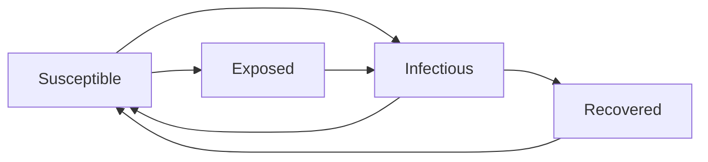

# Planning the Inclusion of Infection Dynamics in AMR-Hub

## Overview

In order to begin tracking the infection dynamics of the organisms and strains that have been identified to be of interest, AMR-Hub is in need of a proper infection module that keeps track of select organisms and their properties, tests for pathogen identification, models the spread of infections, and updates disease progression every time step. Below is a brief foray into the way infections are typically represented within medical and research contexts, and how the AMR-Hub infection module can progress in light of this.

## Stages of Infection [1, 2]

1. **Exposure (via Chain of Infection)**
   - Susceptible host comes into contact with causative agent (pathogen) in a reservoir (environment that can sustain the pathogen).
     - Susceptibility of host can depend on immune response/deficiency (affected by antibodies, age, etc.) and strain of pathogen.
     - Most common reservoirs: humans, animals, water, food, environmental surfaces.
   - Causative agent leaves its reservoir through a portal of exit (e.g. bodily fluids) and enters the host through a portal of entry (e.g. respiratory tract, intestines, wounds).
     - Transmission occurs if a pathogen can survive the entry/exit process and successfully adhere to (i.e. colonise) the cells of the body, which is why contact (direct or indirect) is the most common mode of transmission.
2. **Incubation Stage**
   - Pathogen has successfully entered host and begins to multiply. Host remains asymptomatic.
3. **Prodromal Stage**
   - Initial appearance of mild or vague symptoms due to immune system activation (e.g. inflammation, fever, pain).
4. **Illness Stage**
   - Disease-specific symptoms appear. Peak of infection; high likelihood of contagion.
   - Successfully combating the pathogen will cause it to enter a period of decline.
5. **Convalescence Stage**
   - Period of recovery and healing. Symptoms fade and host system attempts to return to baseline.

## Infectious Disease Modelling

A common way to monitor infections is by using `SEIR` (`susceptible`, `exposed`, `infectious`, `recovered`) states [3], or some variation thereof (`SIR`, `SIRS`, `SIS`, `SEIS`, `SEIRS`, etc.). Models that include the `exposed` state account for the incubation stage where an individual is infected but not infectious, and models that include the `recovered` state account for some level of resistance or immunity upon recovery.

`SEIR` is a useful model for understanding epidemic waves, but state transition equations generally use fixed parameter/probability values and there is a lack of consideration for symptoms and preventative measures.

### Existing Research

One of the most variable aspects of infection models is their scale and complexity, as these characteristics must be tailored to the questions a model is aiming to address. For example, to achieve more realistic results, multiscale models of infection [4] are an emerging approach aimed at helping researchers parse the infection dynamics observed in the real world. This variability can make it difficult to compare different models like-for-like, but their underlying logic can be studied on its own merits.

Below is a small selection of prior research that contains useful points of comparison for AMR-Hub, and ideas for what may be most helpful to include in an infection module.

- [Abadeer, Magharious, and Gorlatch, 2022](https://journals.sagepub.com/doi/10.1177/00375497221133849) [5] layered a `SIR` model on top of an agent-based pedestrian dynamics approach (implemented as an extension of the Vadere simulation framework) to track COVID-19 infection transmission. The effectiveness of protective measures in both large- (citywide) and small- (common indoor environments) scale scenarios was simulated and predicted.
  - One of the stated limitations of the methodology is that "scenarios do not simulate multiple virus mutations with different infection rates simultaneously".

- [Khaokaew et al., 2026](https://arxiv.org/html/2606.06360v1) [6] implemented `SEIR` in an agent-based 'patterns of life' simulation and introduced LLM decision-making for agents based on demographic prompts and situational context. Decisions to self-report an influenza-like illness were measured at a city scale and reporting rate variation was analysed.
  - An alteration to `SEIR` was made by introducing `symptomatic` / `asymptomatic` sub-states to the `infectious` state in order to allow agents to make more informed decisions.

- [Kim et al., 2023](https://www.nature.com/articles/s41598-023-47296-1) [7] combined `SEIRD` (where the final state is `deceased`) with an agent-based model, an epidemiological compartmental model, and the policies and structure of a healthcare environment to generate synthetic data of inpatients in hospitals. The simulation monitored Clostridioides difficile infections and decision-making in a hospital, detected spatial-temporal patterns, and predicted statistical data about the disease.
  - The main goal of the model was to generate higher-quality, realistic synthetic datasets for later use in AI implementations.

- [Ramaswamy, Oberai, and Yortsos, 2021](https://pmc.ncbi.nlm.nih.gov/articles/PMC7833503/) [8] developed a chemical process equivalent of the `SIR` model to capture the spatio-temporal spread of human-transmitted infections like COVID-19. The inclusion of areal densities was shown to affect disease progression, and the inclusion of diffusion generated a wave-like propagation of infection.
  - This model can predict the speed of infection waves at a large scale by using population density and spatial mobilities (included through diffusion and advection), but its focus on physico-chemical principles could be applied to smaller scales as well.

- [Durazzi et al., 2023](https://www.nature.com/articles/s41598-023-42511-5) [9] adapted the Ross-Macdonald model (a deterministic mathematical model of mosquito-borne pathogen transmission) to describe hospital cross-transmission dynamics of resistant Klebsiella pneumoniae (CRKP) bacteria. The model predicts the impact of interventions in reducing the prevalence of CRKP colonisation and infection.
  - One of the stated limitations of the methodology is that "environmental contribution and patient-to-patient transmission were not modelled", and that "given the low numbers of infected patients, the choice of a stochastic approach could have been more informative in terms of model variability".

### Novelty

According to [Garira, 2018](https://www.sciencedirect.com/science/article/pii/S2468042718300113) [10], the frontiers of multiscale modelling of infectious disease systems lie more closely to the frontier of mathematical technology rather than the frontiers of conceptual frameworks or scientific applications. One of the challenges at the technical frontier our work may be able to take steps towards addressing is the development of multiscale models to account for the evolution of pathogens across scales.

There is much existing research that focuses on a single illness or pathogen, but we have the data to create a model tracking multiple strains and organisms simultaneously. By writing an individual-based infection module, we can make a publicly accessible piece of software that could be used to identify patterns in pathogen infections, such as comorbidities, strain dominance, and other interactions.

Based on an analysis by [Doran et al., 2023](https://www.sciencedirect.com/science/article/pii/S1755436523000609) [11], another issue that needs further exploration is capturing the impact of human behaviour on pathogen transmission. Our work could be well-paced to tackle this question as well, given that ABMs excel at modelling unique individual properties and emergent behaviours.

## References

[1] Bowen, C. (2024). Clinical Nursing Skills, 6.1: Infection cycle. LibreTexts. <https://med.libretexts.org/Bookshelves/Nursing/Clinical_Nursing_Skills_(OpenStax)/06%3A_Infection_Prevention_Techniques_and_Safety_in_the_Clinical_Setting/6.01%3A_Infection_Cycle>.

[2] Ernstmeyer, K., & Christman, E. (Eds.). (2024). Nursing Fundamentals 2e, 9.4 Infection. Open RN | WisTech Open. <https://wtcs.pressbooks.pub/nursingfundamentals/chapter/9-4-infection>.

[3] Bjørnstad, O.N., Shea, K., Krzywinski, M. and Altman, N. (2020). The SEIRS model for infectious disease dynamics. Nature Methods 17, 557-558. <https://www.nature.com/articles/s41592-020-0856-2>.

[4] Talman, L., Agmon, E., Peirce, S.M. and Covert, M.W. (2019). Multiscale models of infection. Current Opinion in Biomedical Engineering 11, 102-108. <https://www.sciencedirect.com/science/article/abs/pii/S2468451119300509>.

[5] Abadeer, M., Magharious, S. and Gorlatch, S. (2022). Modeling and interactive simulation of measures against infection transmission. SIMULATION 99(4), 327–346. <https://journals.sagepub.com/doi/10.1177/00375497221133849>.

[6] Khaokaew, Y., Kong, R., Zufle, A., Hao, X., Anderson, T., Raina, M.C., Scotch, M., Salim, F.D. and Heslop, D.J. (2026). An infectious disease spread simulation based on large language model decision making. arXiv. <https://arxiv.org/abs/2606.06360v1>.

> **Khaokaew et al., 2026** later published in Proceedings of the 32nd ACM SIGKDD Conference on Knowledge Discovery and Data Mining V.2, 11248–11259. <https://dl.acm.org/doi/10.1145/3770855.3818983>.

[7] Kim, D., Canovas-Segura, B., Jimeno-Almazán, A., Campos, M. and Juarez, J.M. (2023). Spatial-temporal simulation for hospital infection spread and outbreaks of Clostridioides difficile. Scientific Reports 13, 20022. <https://www.nature.com/articles/s41598-023-47296-1>

[8] Ramaswamy, H., Oberai, A.A. and Yortsos, Y.C. (2021). A comprehensive spatial-temporal infection model. Chemical engineering science 233, 116347. <https://pmc.ncbi.nlm.nih.gov/articles/PMC7833503>.

[9] Durazzi, F., Maria Diletta Pezzani, Fabiana Arieti, Simonetti, O., Lorenzo Maria Canziani, Carrara, E., Barbato, L., Onorati, F., Remondini, D. and Tacconelli, E. (2023). Modelling antimicrobial resistance transmission to guide personalized antimicrobial stewardship interventions and infection control policies in healthcare setting: A pilot study. Scientific Reports 13(1). <https://www.nature.com/articles/s41598-023-42511-5>.

[10] Garira, W. (2018). A primer on multiscale modelling of infectious disease systems. Infectious Disease Modelling 3, 176–191. <https://www.sciencedirect.com/science/article/pii/S2468042718300113>.

[11] Doran, J.W.G., Thompson, R.N., Yates, C.A. and Bowness, R. (2023). Mathematical methods for scaling from within-host to population-scale in infectious disease systems. Epidemics 45, 100724. <https://www.sciencedirect.com/science/article/pii/S1755436523000609>.
