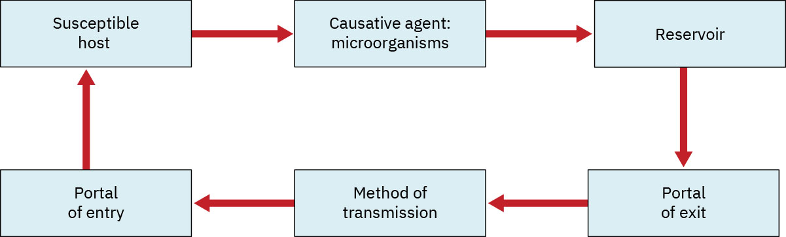
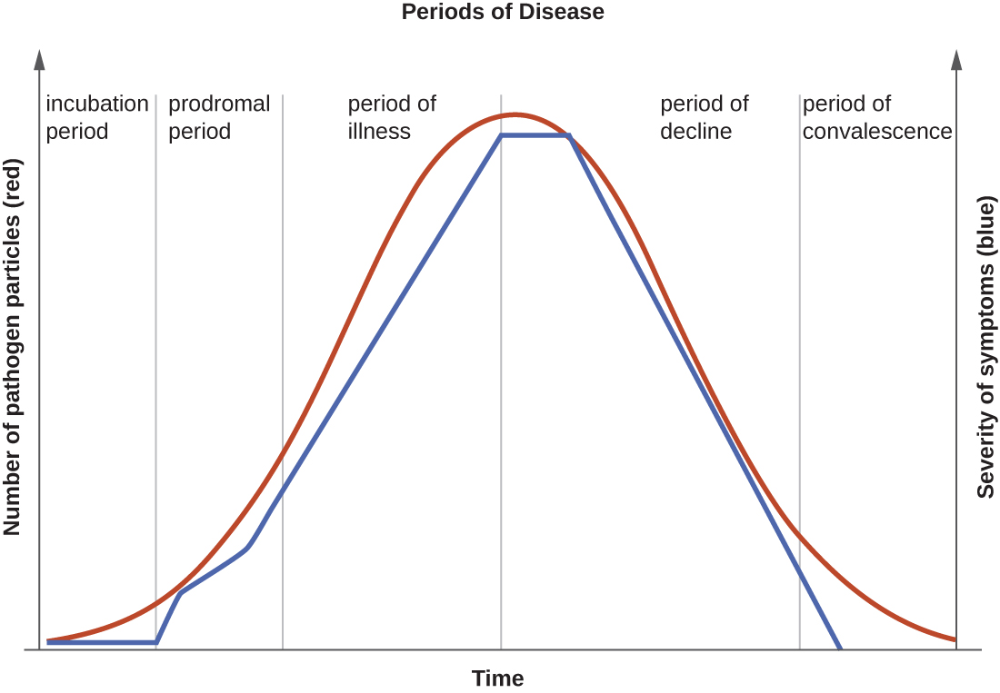
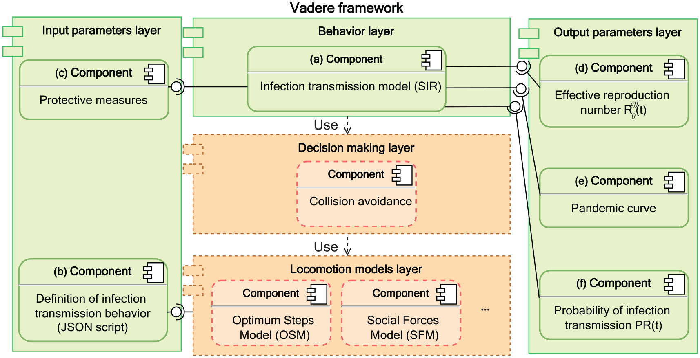
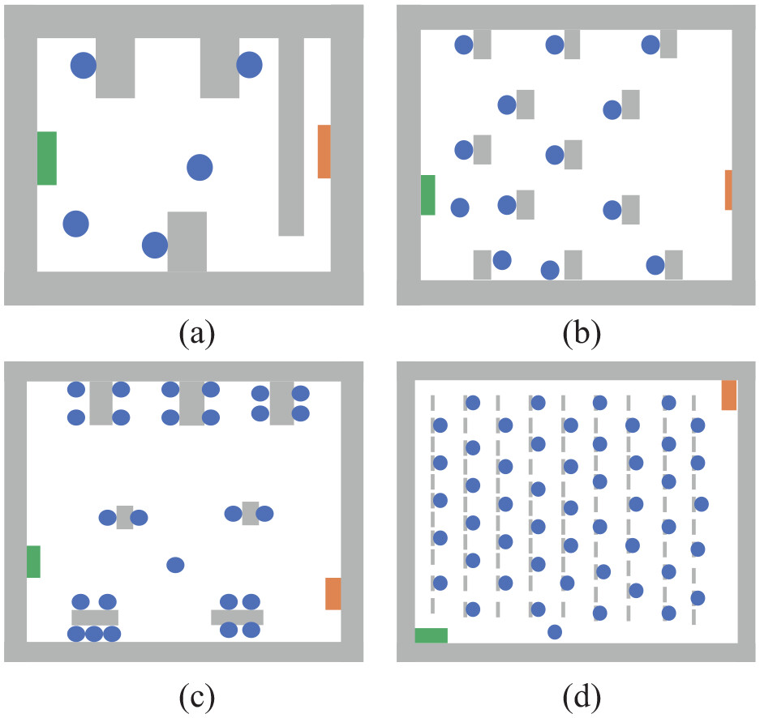
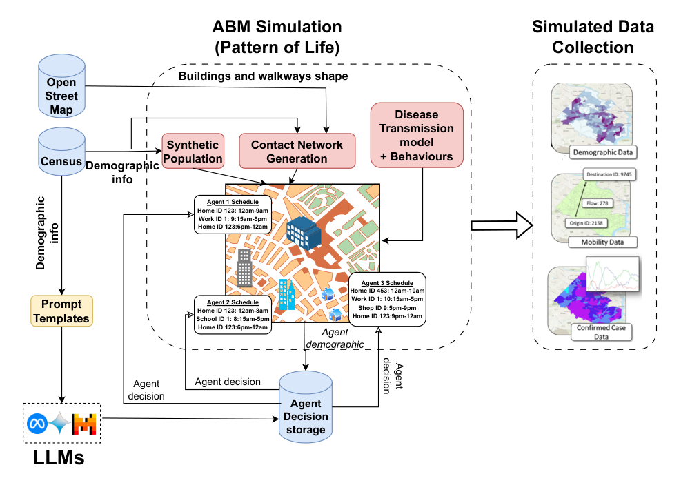
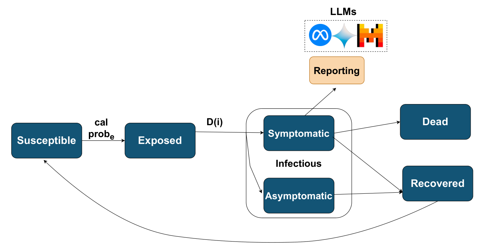
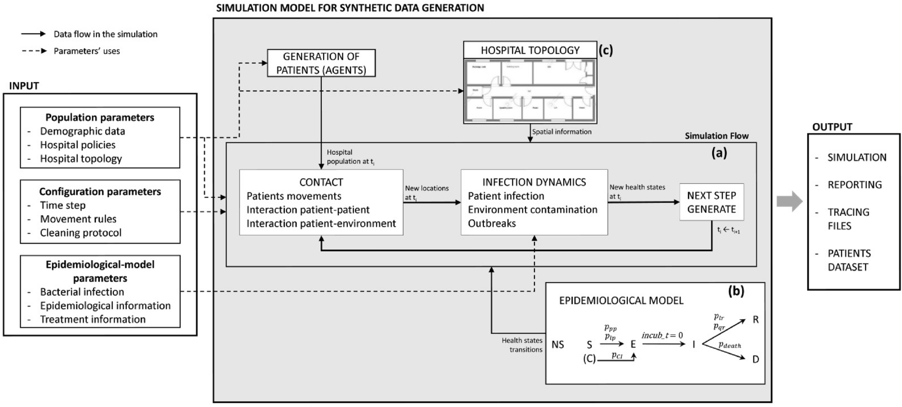

<!-- markdownlint-disable MD025 MD036 MD033 -->

# Infection Modelling

**What is AMR-Hub missing?**

An infection module that:

- Keeps track of organisms of interest and their properties.
- Tests for pathogen identification.
- Models the spread of infections.
- Updates disease progression every time step.

---

# Stages of Infection

## Exposure

**Chain of Infection**

Figure from Bowen, C. (2024). Clinical Nursing Skills, 6.1: Infection cycle.

---

- Host comes into contact with a pathogen in an environment that can sustain the pathogen.
- Pathogen leaves its reservoir through a portal of exit and enters the host through a portal of entry.
- Transmission occurs if a pathogen can survive the entry/exit process and successfully colonise the cells of the body.

---

## Periods of Disease

Figure from Ernstmeyer, K., & Christman, E. (Eds.). (2024). Nursing Fundamentals 2e, 9.4 Infection.

---

**Incubation Stage**

- Pathogen has successfully entered host and begins to multiply. Host remains asymptomatic.

**Prodromal Stage**

- Initial appearance of mild or vague symptoms due to immune system activation (e.g. inflammation, fever, pain).

**Illness Stage**

- Disease-specific symptoms appear. Peak of infection; high likelihood of contagion.
- Successfully combating the pathogen will cause it to enter a period of decline.

**Convalescence Stage**

- Period of recovery and healing. Symptoms fade and host system attempts to return to baseline.

---

# Infectious Disease Modelling

Infections often monitored with `SEIR` (`susceptible`, `exposed`, `infectious`, `recovered`) states...

flowchart LR
   S[Susceptible] --> E[Exposed]
   E --> I[Infectious]
   I --> R[Recovered]

...or some variation thereof (`SIR`, `SIRS`, `SIS`, `SEIS`, `SEIRS`, etc.).

flowchart LR
   S[Susceptible] --> E[Exposed]
   S --> I[Infectious]
   E --> I
   I --> R[Recovered]
   R --> S
   I --> S

---

- The `susceptible` state marks people who can be infected.
- The `exposed` state is roughly equivalent to the incubation stage where an individual is infected but not infectious.
- The `infectious` state marks people that can pass their infection on to others.
- The `recovered` state marks people with some level of resistance or immunity upon recovery.

---

# Case Studies of Existing Research

## Abadeer, Magharious, and Gorlatch, 2022

---

- SIR model.
- Extension of Vadere simulation framework (pedestrian dynamics).
- Apply to COVID-19 infection transmission in both large-scale (e.g. city wide) and small-scale (e.g. office, classroom, restaurant, hall, etc.) scenarios and study effect of preventative measures.

---

- Small-scale scenarios look similar in spirit to what we would like to simulate using hospital floorplans.

---

## Khaokaew et al., 2026

---

- SEIR model.
  - Symptomatic sub-state used to make alterations to agent behaviour.
- Agents use LLM generated decisions based on demographic prompts and situational context.
- Decisions to self-report illness within a city are measured.

---

- A symptomatic sub-state would be a good trigger for preventative measures and testing.

---

## Kim et al., 2023

---

- SEIRD model (D stands for deceased).
  - Added non-susceptible (NS) state to represent immunity.
- Simulation monitors C. diff infections and decision-making in a hospital, detects spatial-temporal patterns, and predicts statistical data about the disease.

---

# Available Data and What We Can Do With It

- We have organisms and strains of interest we want to study transmission for, but no symptom data.
  - Symptoms can be important to decision-making, so we could include a simulated `symptomatic` sub-state for the `infectious` state and introduce organism-specific transition probabilities.
- We can study infection data for multiple organisms in parallel.
- Focus on transmission through contact as currently defined in the simulation, adding room for expansion where possible.
  - Consider also transmission mechanisms for different organisms and what additional implementations they may require.
