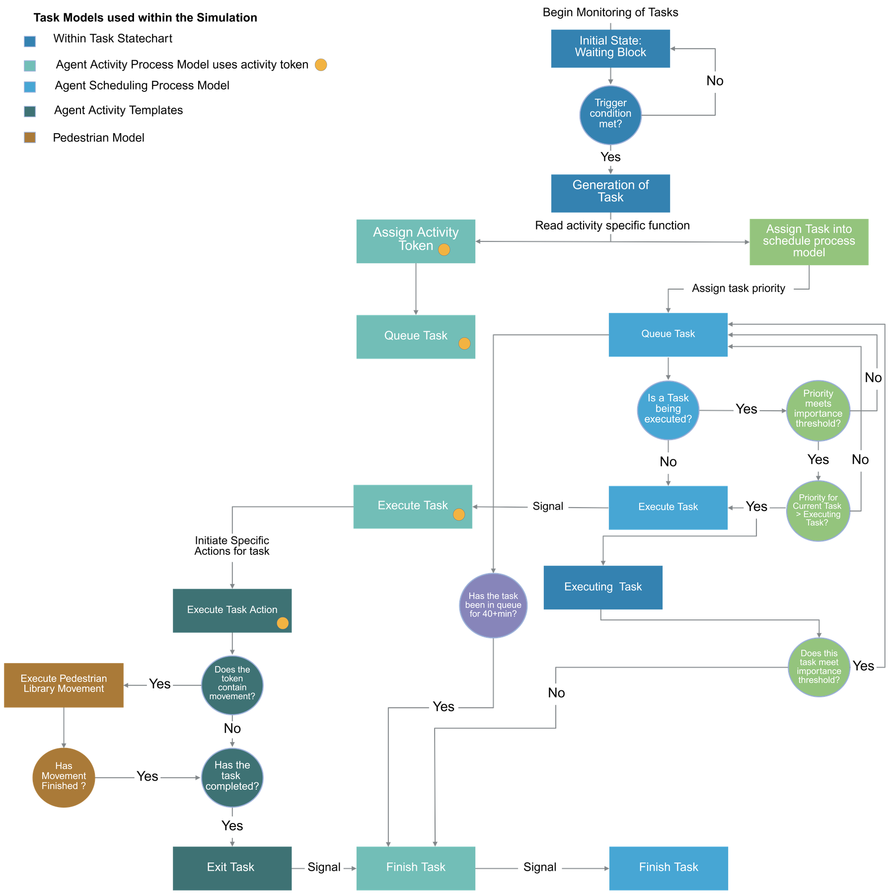
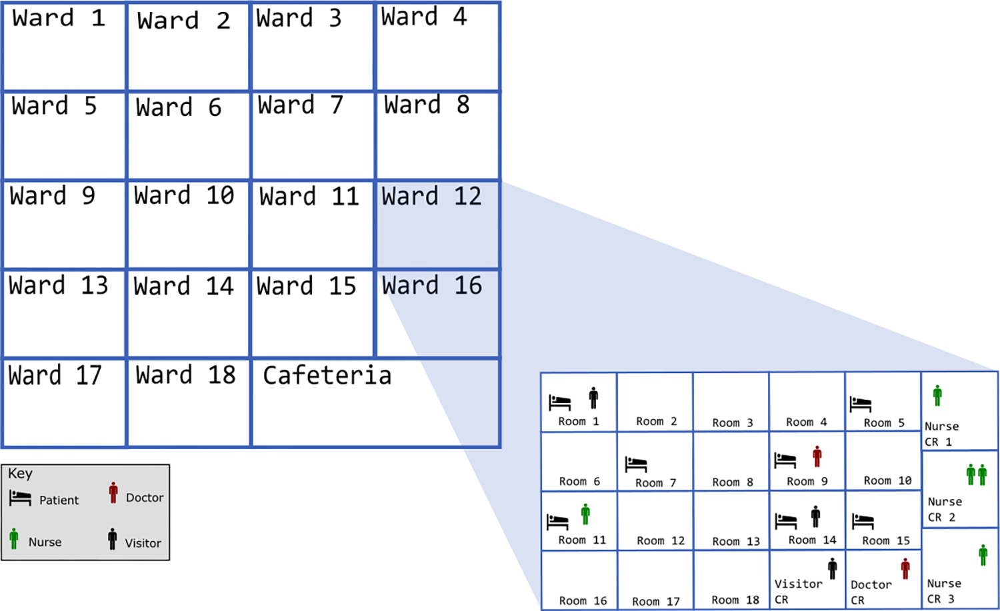
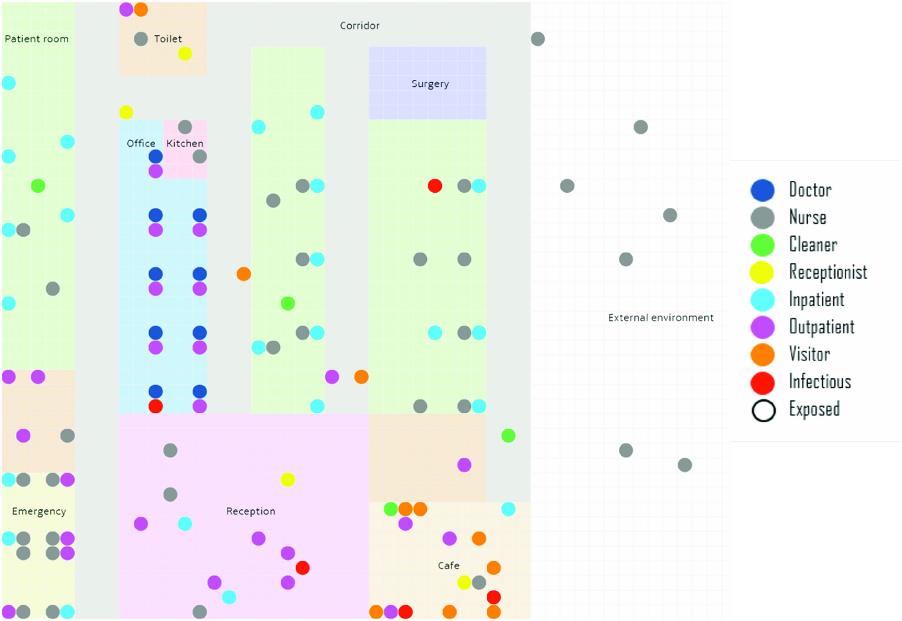
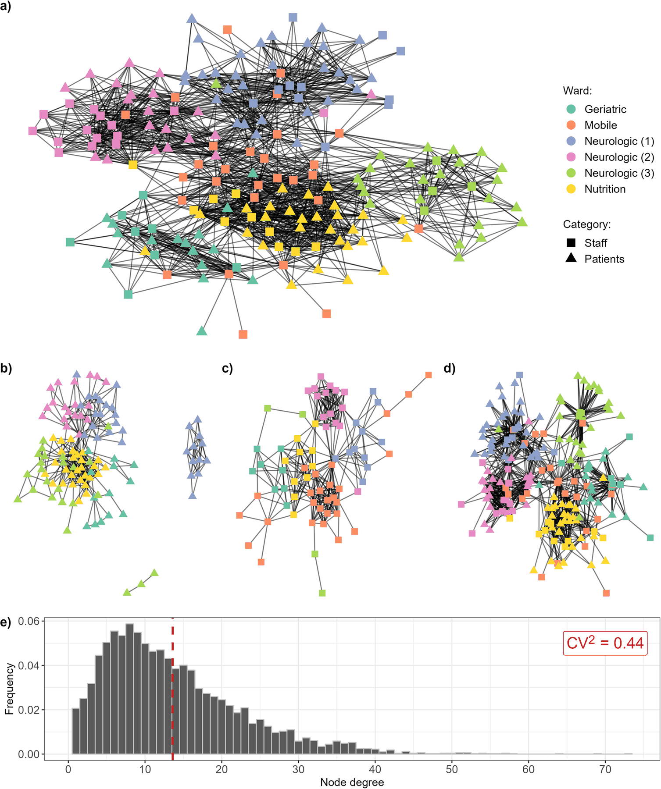
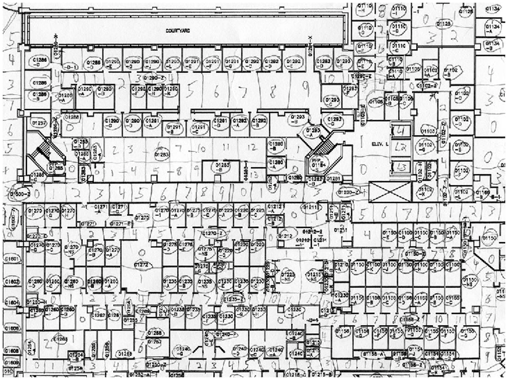

<!-- markdownlint-disable MD025 MD036 -->

# Task-driven mobility

## Filling gaps in hospital records

**A comparison of approaches for AMR-Hub**

CAD + operational events + infection data → simulation and counterfactuals

---

# Why model the gaps?

**Recorded:** care interactions, door access, workstation events

**Often unrecorded:** tailgating, routes, meals, toilets, rest, social time

> A missing event is not evidence that nothing happened.

---

# Two questions, two modes

**Reconstruction:** What could have happened between observed anchors?

**Counterfactual:** What might change if staffing, layout or policy changed?

Do not automatically fix future events in both.

---

<!-- _class: approaches -->

# The approaches at a glance

| Approach                 | How it works                                                                                              | References                                                                                      |
| ------------------------ | --------------------------------------------------------------------------------------------------------- | ----------------------------------------------------------------------------------------------- |
| Scheduled / diary        | Replay or sample activities, times and durations for each role or shift.                                  | [H1](https://doi.org/10.18564/jasss.5993), [H4](https://doi.org/10.1016/j.cmpb.2011.02.002)     |
| Role-based rules         | Set ward access by role; allow staff a cafeteria visit once per shift.                                    | [H2](https://doi.org/10.1371/journal.pone.0284611)                                              |
| Stochastic               | Sample the next activity and its duration, potentially conditioned on role or time.                       | [H3](https://doi.org/10.1371/journal.pone.0326350)                                              |
| Needs / utility          | Choose feasible activities using needs, such as hunger, or a score balancing preferences and constraints. | [G1](https://doi.org/10.1038/s41370-019-0156-z), [G2](https://doi.org/10.3929/ethz-b-000206133) |
| BDI                      | Select and revise plans using beliefs, goals and current commitments.                                     | [G3](https://gama-platform.org/wiki/1.9.1/BDIAgents_step2)                                      |
| LLM-based                | Generate activities from needs and context; G4 evaluates text plausibility, not hospital movement.        | [G4](https://doi.org/10.48550/arxiv.2412.06435)                                                 |
| Network synthesis        | Sample who meets whom and when from observed contact patterns; no walking paths.                          | [H5](https://doi.org/10.1371/journal.pcbi.1012227)                                              |
| Routine-record inference | Estimate contacts from computer logins close in time and room-graph distance.                             | [H6](https://doi.org/10.1371/journal.pone.0079906)                                              |

**Compare with:** direct travel or waiting.

---

# H1 · Tasks, priorities and movement

**Aged-care workers and residents**

- Survey-informed activity timings
- Task queues, priorities and statecharts
- Pedestrian model executes movement

_Stone et al. (2026), [Fig. 2](https://doi.org/10.18564/jasss.5993) · [CC BY 4.0](https://creativecommons.org/licenses/by/4.0/) · resized._

---

# H2 · Hospital-specific room model

**A real hospital's structure + behaviour rules**

- Hospital walk-through informs ward layout
- Nurses work within a ward; doctors cross wards
- A cafeteria visit may occur once per shift

_Scaria et al. (2023), [Fig. 2](https://doi.org/10.1371/journal.pone.0284611.g002) · [CC BY 4.0](https://creativecommons.org/licenses/by/4.0/) · resized._

---

# H3 · Probabilistic room choices

**A synthetic hospital on a grid**

- Room choices and dwell times depend on role
- Opening hours, occupancy and care rules constrain choices
- Movement probabilities are assumed, not observed

_Michaelides & Sarkadi (2025), [Fig. 1](https://doi.org/10.1371/journal.pone.0326350.g001) · [CC BY 4.0](https://creativecommons.org/licenses/by/4.0/) · resized._

---

# H4 · Shifts and ward rounds

**A ward-level model of MRSA transmission**

- Recorded staff shifts and patient data inform the model
- Caregiver movement during ward rounds generates encounters
- Stochastic transmission is calibrated against infection prevalence
- Infection fit does not validate individual movement

[Milazzo et al. (2011)](https://doi.org/10.1016/j.cmpb.2011.02.002)

---

# H5 · Generate contacts directly

**A non-spatial alternative**

- Use observed proximity patterns by role, ward and hour
- Sample recurring contacts and missing periods
- Produces a network, not walking routes

_Duval et al. (2024), [Fig. 1](https://doi.org/10.1371/journal.pcbi.1012227.g001) · [CC BY 4.0](https://creativecommons.org/licenses/by/4.0/) · resized and colour-reduced._

---

# H6 · Routine records as proxies

**Computer sessions + room graph**

- Login events constrain possible locations
- Graph distance and timing inform estimated contacts
- Events are not room crossings or observed touch

_Curtis et al. (2013), [Fig. 1](https://doi.org/10.1371/journal.pone.0079906.g001) · [CC BY 4.0](https://creativecommons.org/licenses/by/4.0/) · resized and colour-reduced._

---

# G1 · Needs-driven activities

**General population · Brandon and Price**

- Hunger, sleep and other needs change over time
- Agents select actions to satisfy competing needs
- Time-use data calibrate and evaluate activity patterns

**Limitation:** not a validation of healthcare-worker behaviour.

[Brandon & Price (2019)](https://doi.org/10.1038/s41370-019-0156-z)

---

# G2 · Scheduling flexible activities

**Urban mobility · Ordóñez**

- Schedule flexible activities within available time windows
- Use survey-derived timing and duration distributions
- Utility helps choose between possible activities

**Limitation:** transport setting; review based on the public abstract.

[Ordóñez (2017)](https://doi.org/10.3929/ethz-b-000206133)

---

# G3 · Beliefs, desires and intentions

**GAMA platform tutorial · not a healthcare study**

- Beliefs represent what an agent knows
- Desires represent goals; intentions guide selected plans
- Agents can reconsider plans as conditions change

**Use:** illustrates a BDI implementation, not evidence of HCW accuracy.

[GAMA BDI tutorial](https://gama-platform.org/wiki/1.9.1/BDIAgents_step2)

---

# G4 · LLM-generated activities

**Desire-driven agents · Wang et al.**

- An LLM proposes and selects activities to address changing needs
- Needs include social interaction, fulfilment and self-care
- Evaluated in a text-based simulator for activity plausibility

**Limitation:** not validated against hospital movement or contacts.

[Wang et al. (2024 preprint)](https://doi.org/10.48550/arxiv.2412.06435)

---

# Needs versus full BDI

**Needs-driven:** “I am hungry; can I fit a meal?”

**BDI:** “What do I know, want and intend—and should I reconsider?”

Start with needs; add explicit beliefs and intentions when they help.

---

# AMR-Hub · Current foundations

**Already present**

- Task lifecycle, locations, timing and chair insertion
- Hunger, toilet need and HCW fatigue state

**Not yet connected**

- Needs do not generate or complete activities
- No full BDI deliberation loop in the inspected paths

---

# Can an activity fit the gap?

**10:00 at A → 10:40 at B**

- Travel to C: **5 min**
- Break at C: **12 min**
- Travel to B: **7 min**
- Buffer: **4 min**

**28 ≤ 40 minutes** — feasible under these assumptions.

---

# Generating a candidate activity

**Update needs → generate → filter → choose → execute**

Protect care obligations and staff coverage.

Track observed, inferred and sampled events separately.

---

# Compare like with like

| Baseline | Gap-filling rule               |
| -------- | ------------------------------ |
| **B0**   | Direct travel / waiting        |
| **B1**   | Scheduled or stochastic breaks |
| **B2**   | Needs-driven activities        |
| **B3**   | BDI, if a concrete need arises |

Also compare a network-only model when contact data permit.

---

# What would make it credible?

1. Audit observation and missingness
2. Verify feasible routes and care constraints
3. Test held-out events and independent observations
4. Compare contact distributions and decision robustness

**Uncertainty belongs in the results.**

---

# Recommended path

**1** Establish direct-travel and scheduled baselines

**2** Add a small, optional needs-driven model

**3** Evaluate against data and sensitivity scenarios

**4** Introduce richer BDI only if it improves the intended use

---

# Takeaway

**The goal is the integrated platform.**

Task-driven mobility is one way to make incomplete hospital records useful for simulation.

> Plausible simulated contact opportunities are not observed contacts.

---

# References and figure credits

**Healthcare:** [H1](https://doi.org/10.18564/jasss.5993) · [H2](https://doi.org/10.1371/journal.pone.0284611) · [H3](https://doi.org/10.1371/journal.pone.0326350) · [H4](https://doi.org/10.1016/j.cmpb.2011.02.002) · [H5](https://doi.org/10.1371/journal.pcbi.1012227) · [H6](https://doi.org/10.1371/journal.pone.0079906)

**General:** [G1](https://doi.org/10.1038/s41370-019-0156-z) · [G2](https://doi.org/10.3929/ethz-b-000206133) · [G3](https://gama-platform.org/wiki/1.9.1/BDIAgents_step2) · [G4](https://doi.org/10.48550/arxiv.2412.06435)

Full citations and search limitations: [review](./task-driven-mobility-review.md).

Paper figures: **CC BY 4.0**, attributed on their slides.
